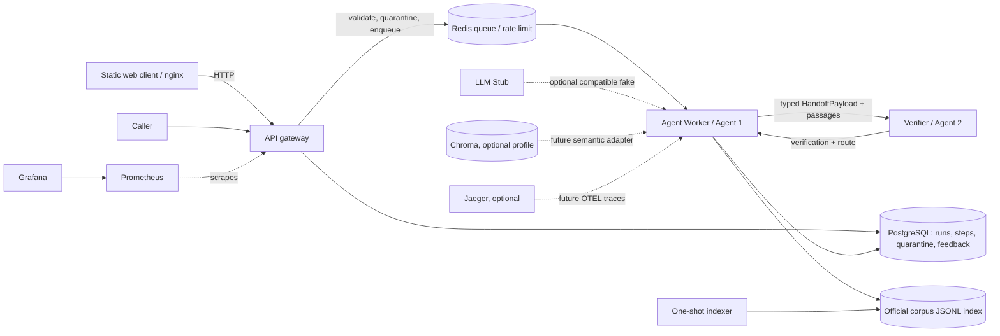

# Architecture and deployment boundaries

## Boundaries and rationale

- **API** is a low-latency independent process. It validates before queueing, writes field-level errors to quarantine, applies a per-client rate limit, and returns a run ID rather than holding an HTTP connection while analysis runs.
- **Agent worker** is independently scalable because retrieval/classification work and future model calls have a different CPU/network profile than request validation. It consumes Redis run IDs and stores ordered trace steps in PostgreSQL.
- **Verifier** is a separate HTTP process with independent availability and a distinct trust boundary. It checks that citation identifiers resolve to the passage set in the handoff. If it is unreachable, worker output is downgraded to a degraded specialist-review route.
- **Redis** owns queue hand-off and the rate-limit counter. **PostgreSQL** owns durable state. This avoids treating a queue item as the only record of a request.
- **Web/nginx** is static and can be released without rebuilding the API.
- **llm-stub** is a separately health-checked OpenAI-compatible fake for development; the deterministic evidence-first graph does not need external model calls by default.
- **Indexer** is a one-shot process. It runs only after the user supplies current official documents. The currently active index is a JSONL lexical index; the Chroma service is under the `corpus` profile and is not falsely represented as integrated.
- **Prometheus/Grafana/Jaeger** are optional profile services. Request/latency metrics are real; full cross-process OpenTelemetry spans and per-agent dashboards are deferred.

## Resilience

Malformed requests never enter the queue. Every terminal result includes route and basis. The default result is specialist review when source evidence is absent or weak. An unverified proposed code is never returned. Worker exceptions produce a degraded escalation record instead of a confident classification.
